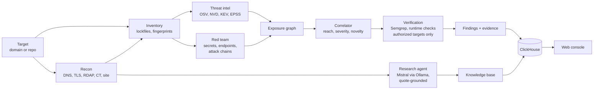

# StackWatch

[](https://github.com/LlamzonAmazon/StackWatch/actions/workflows/ci.yml)

StackWatch is an automated threat-intelligence and penetration-testing team for a software stack. Point it at a public domain or a repository and it maps what the target runs, matches that inventory against published vulnerabilities and live exploitation data, and tests each match from an attacker's side before ranking it. Every finding links to the evidence that produced it.

## How it works

A run moves through five stages. Each agent and skill does one job and writes what it observes to a shared exposure graph. Only the correlator turns that graph into findings, so every finding traces back to an observation.

### 1. Recon: map the target

- Public domains get passive reconnaissance: DNS, mail security (SPF, DMARC, MTA-STS, DKIM), RDAP and hosting, TLS, certificate-transparency subdomains, and the site's own pages and JavaScript bundles.
- A research agent reads what recon fetched and builds a profile of the company behind the domain. Agent inference runs on Mistral models (Ministral 3 8B by default), served locally through Ollama, with read-only tools scoped to the target domain.
- Every fact the agent records must quote its source page verbatim. Facts without a matching quote are rejected.

### 2. Inventory: what it runs

- Repositories are read from their npm lockfile (v1 to v3), so every dependency resolves to an exact version.
- Public domains are fingerprinted from what they already serve: server headers, generator tags, asset filenames, CDN paths and bundle license banners.

### 3. Threat intelligence: what affects it

- Each `package@version` is matched against OSV advisories with deterministic semver ranges. Fingerprinted server software is matched against the NVD by CPE.
- Every match with a CVE is checked against the CISA Known Exploited Vulnerabilities catalog and scored with EPSS, the probability of exploitation in the next 30 days.
- Matching is deterministic code. The language model never decides whether a finding exists.

### 4. Red team: how an attacker would use it

- Scans the repository for exposed secrets, typosquat-like package names, shell or network calls in install scripts, and registry credentials committed in `.npmrc`.
- Enumerates the attack surface of an authorized deployment: routes from `robots.txt`, sitemaps and pages, API and admin endpoints, and well-known sensitive paths such as `/.env` and `/.git/config`.
- Chains findings from every stage into named attack paths mapped to MITRE ATT&CK techniques, each with a written narrative.
- Proves or rules out each match on targets you authorize in `config/demo.yaml`. Semgrep rules check whether the vulnerable call is actually made, and read-only runtime checks probe the live deployment. A confirmed match moves from `present` to `verified`.

### 5. Correlation: what is real risk

- The correlator scores reach (is the vulnerable component on a live route?), severity and novelty. A finding listed in CISA KEV or with an EPSS score of 0.5 or higher moves up one severity level when the package is actually used.
- Each finding carries a claim strength: `present` (version in range), `reachable` (on a route) or `verified` (confirmed by Semgrep or a runtime check).
- Runs, events, advisories and findings are stored in ClickHouse and shown in the web console with the full evidence chain.

Connected repositories stay monitored. A watcher re-runs them on an interval and replays newly published advisories against stored inventories without rediscovering the stack.



More detail: [docs/architecture.md](docs/architecture.md).

## Quickstart

Requires Python 3.12, [uv](https://docs.astral.sh/uv/), Docker, Node (for lockfile generation) and the Semgrep CLI. Ollama is optional; without it the research agent is skipped and recon still runs.

```bash
uv venv --python 3.12 && uv pip install -r pyproject.toml --extra dev   # dev adds pytest and ruff
cp .env.example .env            # fill in ClickHouse credentials and STACKWATCH_API_KEYS
set -a; source .env; set +a
scripts/setup_demo.sh           # clones OWASP Juice Shop, starts ClickHouse, applies schema, loads OSV
DEMO_MODE=1 .venv/bin/python -m uvicorn app.main:app --host 127.0.0.1 --port 3003
```

Open http://127.0.0.1:3003 and scan `demo/juice-shop`, or a domain you are allowed to scan.

Tests: `.venv/bin/python -m pytest -q` (no ClickHouse or network needed). Lint: `.venv/bin/ruff check .`. CI runs both on every push to `main` and every pull request.

## Security model

- **Every `/api` route except `/api/health` needs an `X-API-Key` header.** Set `STACKWATCH_API_KEYS` (comma-separated, 32+ characters, e.g. `openssl rand -hex 32`); the console prompts for it once per tab. With no key set the API answers 503. `STACKWATCH_AUTH_DISABLED=1` turns auth off for local use only.
- Routes that trigger outbound or expensive work (targets, runs, ask, replay) are rate limited per client IP, 20 per minute by default. The limit is per process and keys on the socket address, so behind a reverse proxy all callers share one bucket.
- Outbound fetches go through `safe_fetch`, which blocks private ranges, re-validates every redirect hop and caps response size.
- Active checks (Semgrep, runtime probes) run only against targets pinned in `config/demo.yaml`. Public domains get passive recon only.
- ClickHouse queries that take user input are parameterized. The runtime database user has `INSERT` and `SELECT` only, with credentials from the environment.

The full self-audit is in [docs/security-audit.md](docs/security-audit.md).

## Repository layout

| Path | What it holds |
|------|---------------|
| `app/discovery`, `app/recon` | Inventory: lockfiles, site assets, DNS, TLS, RDAP, CT, SPA bundles |
| `app/agent` | Bounded research agent over an OpenAI-compatible endpoint |
| `app/skills`, `app/correlate` | Exposure graph and the correlator |
| `app/intel` | OSV matching, severity, posture findings, the watcher |
| `app/verify`, `rules/` | Semgrep runner, reachability rules, runtime checks |
| `app/scanner` | Secret scanning, endpoint enumeration, attack-chain patterns |
| `web/` | Static console (vanilla JS, no build step) |
| `docs/` | Goals, architecture, decisions, design system, infrastructure, backlog |

## Status

Runs end to end on local infrastructure. Not deployed. [docs/outstanding.md](docs/outstanding.md) lists what is left, starting with API authentication.

## Credits

StackWatch began as a team build at the SF Tech Week Cyberdefense Hackathon in October 2026. The original codebase is at [AndresPedrerosC/Cyberdefense-Hackathon](https://github.com/AndresPedrerosC/Cyberdefense-Hackathon). This repository adopts it, with a fresh history, for presentation purposes.

- **Thomas Llamzon** ([@LlamzonAmazon](https://github.com/LlamzonAmazon)): agent infrastructure and the full stack.
- **Andres** ([@AndresPedrerosC](https://github.com/AndresPedrerosC)): the agent's web scraping.
- **Sid** ([@inSideos-designs](https://github.com/inSideos-designs)): adversarial pentesting.

[docs/goals.md](docs/goals.md#contributions) has the full breakdown.
