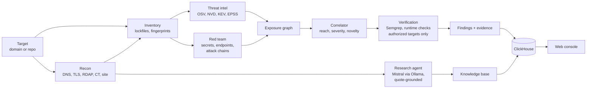

# StackWatch

[](https://github.com/LlamzonAmazon/StackWatch/actions/workflows/ci.yml)

StackWatch is an automated threat-intelligence and penetration-testing team for a software stack. Point it at a public domain or a repository and it maps what the target runs, matches that inventory against published vulnerabilities and live exploitation data, and tests each match from an attacker's side before ranking it. Every finding links to the evidence that produced it.

## How it works

### Reconnaissance

StackWatch maps the target passively: DNS, mail security, TLS, RDAP, certificate-transparency subdomains and the site itself. A research agent running **Mistral models locally through Ollama** profiles the company, and every fact it keeps must quote its source verbatim.

### Inventory

Everything the target runs is resolved to an exact version, from npm lockfiles for repositories or from headers, asset names and bundle banners for live sites.

### Threat Intelligence

The inventory is matched against **OSV** and the **NVD** with deterministic version ranges, and matching CVEs are flagged in **CISA KEV** and scored with **EPSS**. The model never decides whether a finding exists.

### Adversarial Red-Teaming

StackWatch then looks at the target the way an attacker would: exposed secrets, typosquat-like packages, risky install scripts, sensitive endpoints, and **attack chains mapped to MITRE ATT&CK**. On targets you authorize, **Semgrep** and read-only runtime checks confirm whether a vulnerability is actually reachable.

### Correlation

Findings are ranked by reach, severity and exploitation signals, and each is labeled `present`, `reachable` or `verified` with its evidence attached. Connected repositories are re-checked automatically as new advisories are published.



More detail: [docs/architecture.md](docs/architecture.md).

## Quickstart

Requires Python 3.12, [uv](https://docs.astral.sh/uv/), Docker, Node (for lockfile generation) and the Semgrep CLI. Ollama is optional; without it the research agent is skipped and recon still runs.

```bash
uv venv --python 3.12 && uv pip install -r pyproject.toml --extra dev   # dev adds pytest and ruff
cp .env.example .env            # fill in ClickHouse credentials and STACKWATCH_API_KEYS
set -a; source .env; set +a
scripts/setup_demo.sh           # clones OWASP Juice Shop, starts ClickHouse, applies schema, loads OSV
DEMO_MODE=1 .venv/bin/python -m uvicorn app.main:app --host 127.0.0.1 --port 3003
```

Open http://127.0.0.1:3003 and scan `demo/juice-shop`, or a domain you are allowed to scan.

Tests: `.venv/bin/python -m pytest -q` (no ClickHouse or network needed). Lint: `.venv/bin/ruff check .`. CI runs both on every push to `main` and every pull request.

## Security model

- **Every `/api` route except `/api/health` needs an `X-API-Key` header.** Set `STACKWATCH_API_KEYS` (comma-separated, 32+ characters, e.g. `openssl rand -hex 32`); the console prompts for it once per tab. With no key set the API answers 503. `STACKWATCH_AUTH_DISABLED=1` turns auth off for local use only.
- Routes that trigger outbound or expensive work (targets, runs, ask, replay) are rate limited per client IP, 20 per minute by default. The limit is per process and keys on the socket address, so behind a reverse proxy all callers share one bucket.
- Outbound fetches go through `safe_fetch`, which blocks private ranges, re-validates every redirect hop and caps response size.
- Active checks (Semgrep, runtime probes) run only against targets pinned in `config/demo.yaml`. Public domains get passive recon only.
- ClickHouse queries that take user input are parameterized. The runtime database user has `INSERT` and `SELECT` only, with credentials from the environment.

The full self-audit is in [docs/security-audit.md](docs/security-audit.md).

## Repository layout

| Path | What it holds |
|------|---------------|
| `app/discovery`, `app/recon` | Inventory: lockfiles, site assets, DNS, TLS, RDAP, CT, SPA bundles |
| `app/agent` | Bounded research agent over an OpenAI-compatible endpoint |
| `app/skills`, `app/correlate` | Exposure graph and the correlator |
| `app/intel` | OSV matching, severity, posture findings, the watcher |
| `app/verify`, `rules/` | Semgrep runner, reachability rules, runtime checks |
| `app/scanner` | Secret scanning, endpoint enumeration, attack-chain patterns |
| `web/` | Static console (vanilla JS, no build step) |
| `docs/` | Goals, architecture, decisions, design system, infrastructure, backlog |

## Status

Runs end to end on local infrastructure. Not deployed. [docs/outstanding.md](docs/outstanding.md) lists what is left, starting with API authentication.

## Credits

StackWatch began as a team build at the SF Tech Week Cyberdefense Hackathon in October 2026. The original codebase is at [AndresPedrerosC/Cyberdefense-Hackathon](https://github.com/AndresPedrerosC/Cyberdefense-Hackathon). This repository adopts it, with a fresh history, for presentation purposes.

- **Thomas Llamzon** ([@LlamzonAmazon](https://github.com/LlamzonAmazon)): agent infrastructure and the full stack.
- **Andres** ([@AndresPedrerosC](https://github.com/AndresPedrerosC)): the agent's web scraping.
- **Sid** ([@inSideos-designs](https://github.com/inSideos-designs)): adversarial pentesting.

[docs/goals.md](docs/goals.md#contributions) has the full breakdown.
