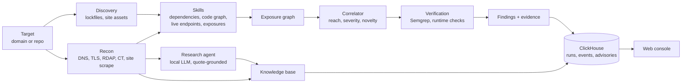

# StackWatch

StackWatch is an exposure agent. Point it at a public domain or a connected repository and it answers three questions: what is this target running, which published vulnerabilities affect it, and which of those are actually reachable.

It inventories the stack (lockfiles, live site assets, DNS, TLS, mail security, certificate transparency), matches every resolved `package@version` against OSV advisories with deterministic semver logic, and then tries to prove or rule out each match with Semgrep reachability rules and scoped runtime checks. Every finding links to the evidence that produced it.

## How it works



1. **Discovery and recon** build an inventory. Repositories are read from their lockfile (v1 to v3); public domains are fingerprinted passively from what they serve.
2. **Skills** each observe one thing and add nodes and edges to an exposure graph. No skill emits findings on its own.
3. **The correlator** joins the graph into findings, scoring reach (is the vulnerable component on a route?), severity and novelty, and assembles multi-step attack chains.
4. **Verification** runs only on targets listed in `config/demo.yaml` as authorized. A Semgrep match upgrades a finding from `present` to `verified`.
5. **The watcher** re-runs connected repositories on an interval and replays new advisories against stored inventories.

More detail: [docs/architecture.md](docs/architecture.md).

## Quickstart

Requires Python 3.12, [uv](https://docs.astral.sh/uv/), Docker, Node (for lockfile generation) and the Semgrep CLI. Ollama is optional; without it the research agent is skipped and recon still runs.

```bash
uv venv --python 3.12 && uv pip install -r pyproject.toml
cp .env.example .env            # fill in ClickHouse credentials at minimum
set -a; source .env; set +a
scripts/setup_demo.sh           # clones OWASP Juice Shop, starts ClickHouse, applies schema, loads OSV
DEMO_MODE=1 .venv/bin/python -m uvicorn app.main:app --host 127.0.0.1 --port 3003
```

Open http://127.0.0.1:3003 and scan `demo/juice-shop`, or a domain you are allowed to scan.

Tests: `.venv/bin/python -m pytest -q` (no ClickHouse or network needed).

## Security model

- **The API has no authentication yet.** Bind it to localhost. It fetches arbitrary domains on request, so a public instance is an SSRF-capable proxy. This is item 1 in [docs/outstanding.md](docs/outstanding.md).
- Outbound fetches go through `safe_fetch`, which blocks private ranges, re-validates every redirect hop and caps response size.
- Active checks (Semgrep, runtime probes) run only against targets pinned in `config/demo.yaml`. Public domains get passive recon only.
- ClickHouse queries that take user input are parameterized. The runtime database user has `INSERT` and `SELECT` only, with credentials from the environment.

The full self-audit is in [docs/security-audit.md](docs/security-audit.md).

## Repository layout

| Path | What it holds |
|------|---------------|
| `app/discovery`, `app/recon` | Inventory: lockfiles, site assets, DNS, TLS, RDAP, CT, SPA bundles |
| `app/agent` | Bounded research agent over an OpenAI-compatible endpoint |
| `app/skills`, `app/correlate` | Exposure graph and the correlator |
| `app/intel` | OSV matching, severity, posture findings, the watcher |
| `app/verify`, `rules/` | Semgrep runner, reachability rules, runtime checks |
| `app/scanner` | Secret scanning, endpoint enumeration, attack-chain patterns |
| `web/` | Static console (vanilla JS, no build step) |
| `docs/` | Goals, architecture, decisions, design system, infrastructure, backlog |

## Status

Runs end to end on local infrastructure. Not deployed. [docs/outstanding.md](docs/outstanding.md) lists what is left, starting with API authentication and the CISA KEV, NVD and EPSS cross-reference.

## Credits

StackWatch started as a four-person team build in October 2026 with Fuad, Sid and Andres. This repository is a fresh history of that codebase, maintained by Thomas Llamzon. [docs/goals.md](docs/goals.md#contributions) records who built what.
