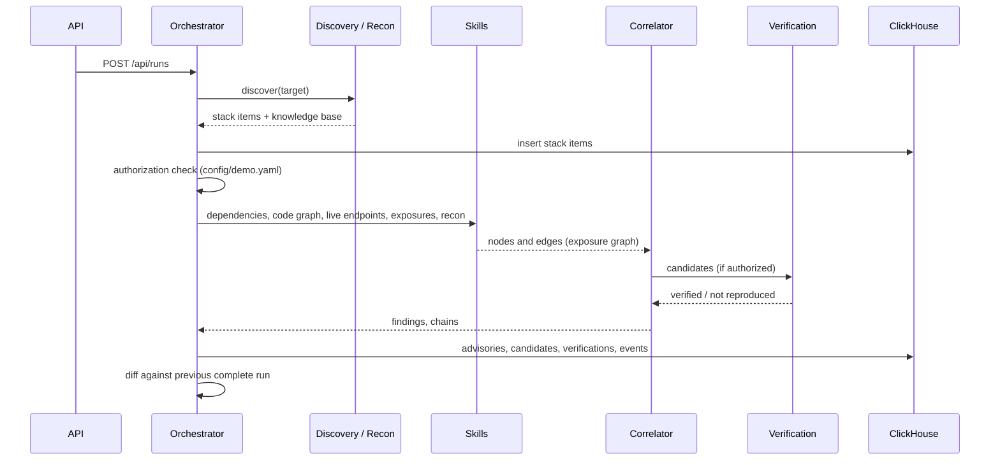

# Architecture

A single FastAPI process (`app/main.py`) serves the JSON API and the static console in `web/`. Runs execute as asyncio tasks, with blocking work pushed to threads. ClickHouse is the system of record.

## Pipeline

`app/orchestrator.py` `run_pipeline` runs one target through these stages. Each stage emits events to the activity feed.

### 1. Discovery (`app/discovery`)

- **Repositories:** parse `package-lock.json` (v1, v2, v3) into exact direct and transitive versions. If no lockfile exists, `npm install --package-lock-only --ignore-scripts` generates one. Repo paths must resolve inside `ALLOWED_REPO_ROOTS`.
- **Public domains:** fetch the site through `safe_fetch` and fingerprint versioned libraries from served assets. Versions are read passively by `app/recon/fingerprint.py` from data recon already holds (no extra requests): `Server` / `X-Powered-By` / `X-AspNet-Version` headers, meta generator, known-library filenames and CDN paths, `?ver=` on WordPress assets, and the leading license comment of bundles that were already downloaded. Only curated products are named, and a version must look like a release number, so cache-busting hashes, timestamps and date stamps never become versions. Confidence: high for explicit banners and CDN pins, medium for filenames and WordPress core `?ver=`, low for a bare query value or a plugin or theme `?ver=`. Distribution builds backport fixes without changing the banner, so a version here means "reports as", not "is vulnerable". Libraries with a high or medium confidence version also become npm stack items for OSV matching.

### 2. Recon and knowledge base (`app/recon`, `app/agent`)

Public-domain runs build a per-run knowledge base: DNS records, mail security (SPF, DMARC, MTA-STS, DKIM), RDAP, ASN and hosting, TLS, crt.sh subdomains, and a scoped scrape including single-page-app bundles. Stored in the ClickHouse `knowledge` table and served at `/api/runs/{id}/knowledge`.

The research agent (`app/agent/research.py`) runs plan, read, extract, profile over an OpenAI-compatible endpoint (local Ollama Ministral 8B by default). Its tools are read-only and limited to the target domain. Every extracted fact must carry a verbatim quote from a fetched page or it is rejected. If the model is unreachable, the run continues recon-only.

### 3. Skills and the exposure graph (`app/skills`, `app/correlate/graph.py`)

Each skill observes one thing and contributes nodes and edges:

| Skill | Observes |
|-------|----------|
| `dependencies` | Advisories for installed packages (OSV, semver range match) |
| `code_graph` | Import and route map of the source |
| `live_endpoints` | Live attack surface of an authorized deployment |
| `exposures` | Secrets and misconfiguration on disk |
| `recon` | Public recon observations |

No skill produces findings directly.

### 4. Correlation (`app/correlate`)

Joins the graph into findings. `reach.py` decides whether a vulnerable component is on a route; `score.py` combines severity, reach and novelty; `narrate.py` writes the explanation.

Exploitation signals come from `app/intel/threat.py`: the dependencies skill looks up CISA KEV and FIRST EPSS for the CVE aliases of matched advisories (cached under `data/cache/intel/`, TTL 12h and 24h, `CACHE_ONLY` honored) and the correlator attaches the result to each finding as `intel`. `GET /api/runs/{id}/report` recomputes it per advisory from the same cache, so nothing new is stored. See D10 in [design-decisions.md](design-decisions.md) for how it moves ranking. `app/scanner/threat_patterns.py` names multi-step attack chains with MITRE mappings.

### 5. Verification (`app/verify`)

Runs only when the target is in `authorized_targets`.

- `semgrep_runner.py` runs the rule for an advisory (`rules/registry.yaml`) with `--metrics=off`. A match upgrades the finding to `verified`.
- `runtime.py` probes an `owned_deployment` host from its `allowed_hosts` list, with scheme, credential and redirect checks.

### 6. Change detection and monitoring (`app/intel/watcher.py`)

The watcher polls connected repositories every `POLL_INTERVAL_SECONDS`, starting a run when the inventory hash changes. `POST /api/advisories/replay` replays a new advisory against stored inventories without rediscovery.

## API

| Method | Path | Purpose |
|--------|------|---------|
| POST | `/api/targets` | Create a target (domain or repo) |
| POST | `/api/runs` | Start a run |
| GET | `/api/runs/{id}` | Run state |
| GET | `/api/runs/{id}/report` | Findings report |
| GET | `/api/runs/{id}/knowledge` | Knowledge base |
| GET | `/api/runs/{id}/vulnscan`, `/endpoints`, `/threats` | Deep-scan results (in memory) |
| GET | `/api/runs/{id}/senso`, POST `/api/runs/{id}/ask` | Senso ingest status and Q&A |
| GET | `/api/targets/{id}/changes` | Diff between runs |
| GET | `/api/events`, `/api/stats`, `/api/health` | Activity feed, counters, health |
| POST | `/api/advisories/replay` | Replay an advisory against stored inventories |

## Storage

ClickHouse database `stackwatch` (`scripts/schema.sql`): `targets`, `runs`, `stack_items`, `advisories`, `candidates`, `verifications`, `events`, `knowledge`. All MergeTree, append-oriented.

Held in memory and lost on restart: deep-scan results, live knowledge bases and in-flight runs (backlog item 10).
